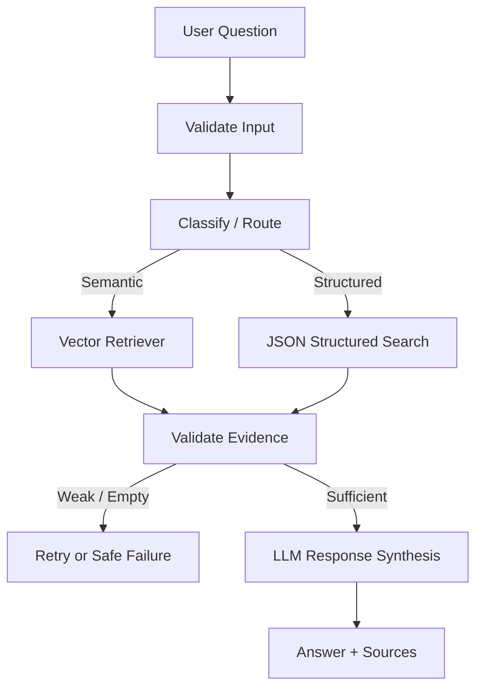

# Event-Driven Workflow

## Steps

1. **Validate Input**
   - Reject empty questions.
   - Reject whitespace-only input.

2. **Route**
   - List/latest/change/rule/warning style questions use structured search.
   - Conceptual questions use semantic retrieval.

3. **Retrieve**
   - Semantic path uses Pinecone through LlamaIndex.
   - Structured path uses the extracted JSON schema.

4. **Validate Evidence**
   - Semantic evidence is evaluated by similarity scores.
   - No evidence results in a safe response rather than hallucination.

5. **Synthesize**
   - OpenAI receives only the question and retrieved evidence.
   - The answer includes source metadata.

## State

The workflow state contains:

- query
- selected route
- routing reason
- evidence
- confidence
- retry count

Events carry only the information needed by the next step.
